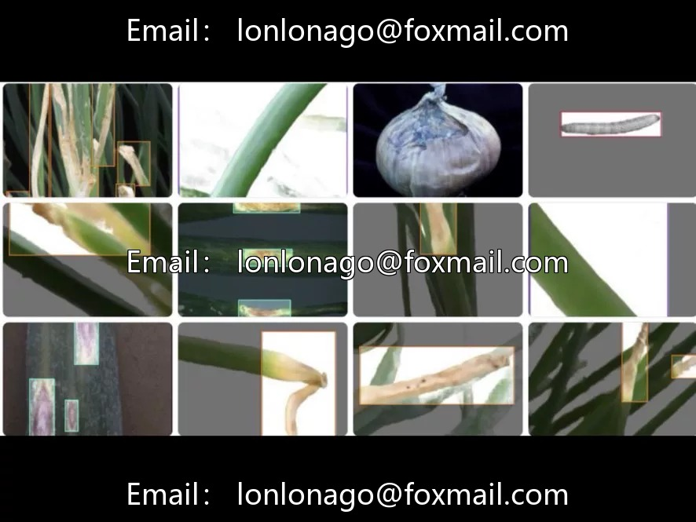
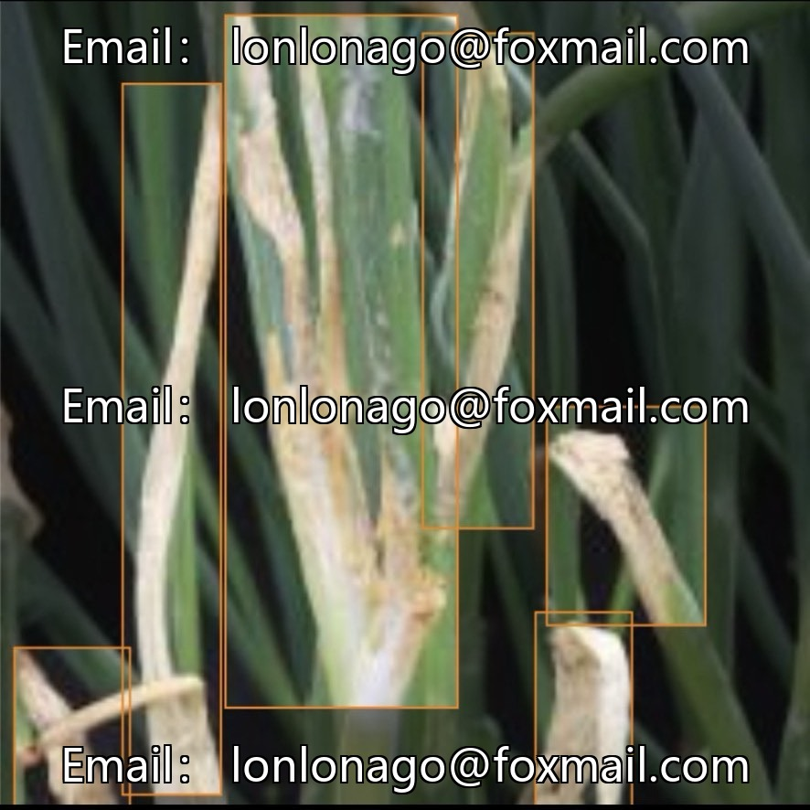
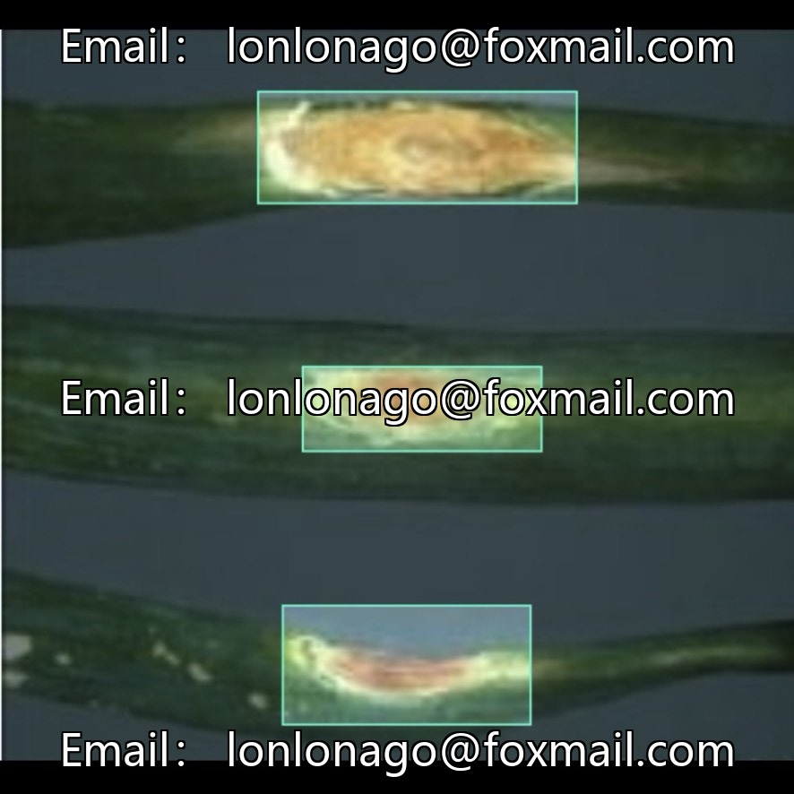
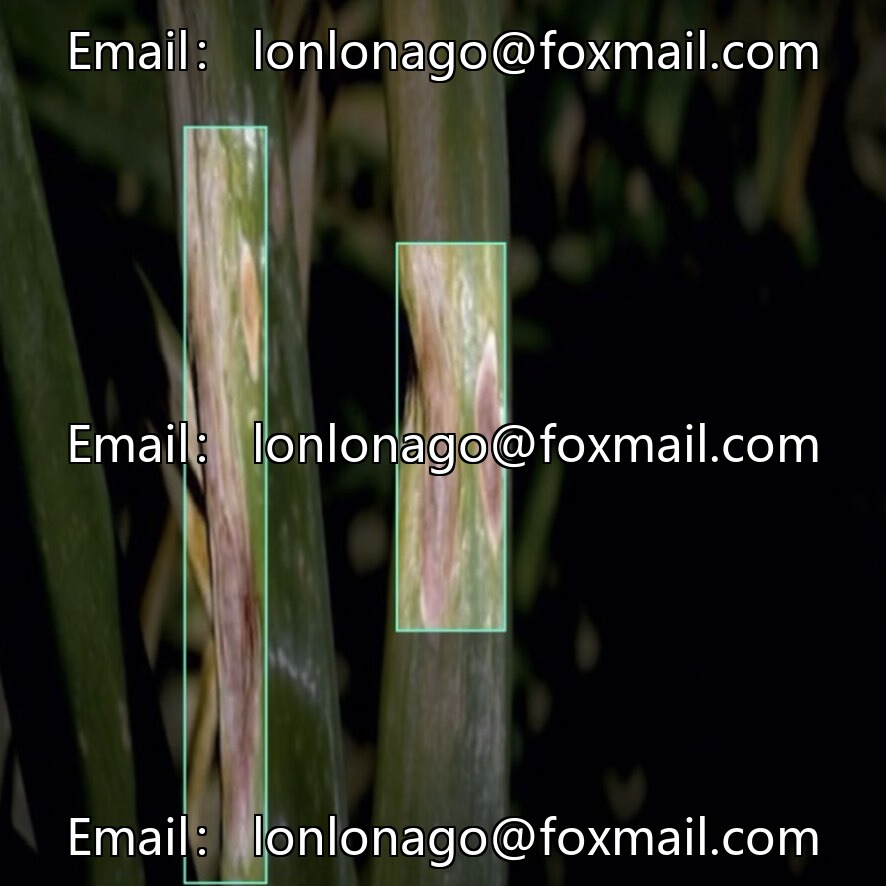
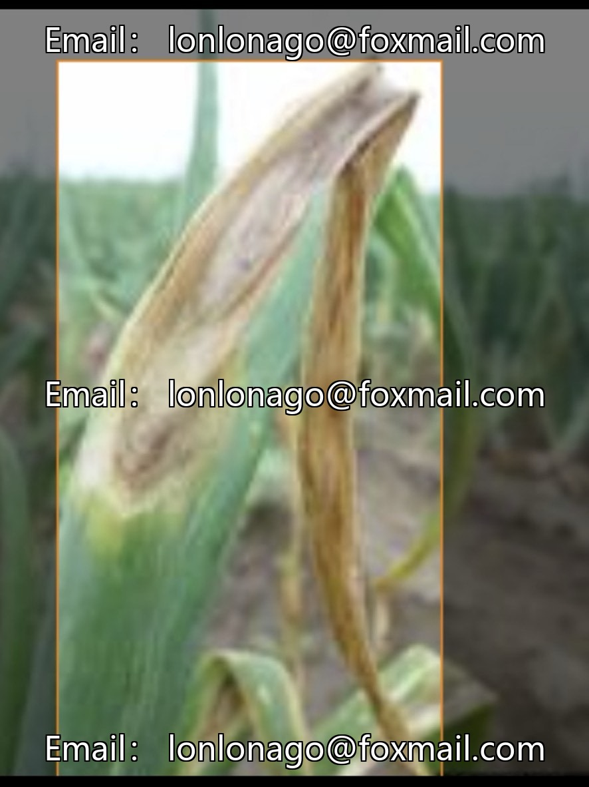

# Onion crop disease dataset | Intelligent Agriculture final project directly hands-on

## Body

Onion Crop Disease YOLO Dataset | Smart Agriculture Degree Project Hands-on
Field onion plant protection target detection dataset, complete training code ready to use✅ 10777th issue
Core parameters overview
▪️Total image quantity: 1358 field real-shot images, covering real farm conditions such as backlighting, leaf obstruction, weed interference
▪️5 types of annotation targets: background clutter, armyworms, healthy leaves, leaf blight, purple blotch disease
▪️Multi-format compatibility: YOLO/VOC/COCO, providing 11 data versions + 4 pre-trained weights
▪️Baseline model performance: mAP@50=89.3%, precision rate 86.9%, recall rate 86.4%

▪️ Supplementary resources: Lightweight YOLOv11 training and inference complete Python code for 26 iterations, one-click execution.
Data set advantages
Synchronously identify two types of fungal diseases and pests + healthy leaves, solving the difficulties in identifying small insects and overlapping disease patches in the field.
Lightweight models are adapted for drones and portable plant protection equipment deployment, balancing academic experiments with field implementation in agriculture.
Three major ground applications
1. Plant Protection Drone Inspection: Large-scale farmland automatically counts the density of diseases and pests.
2. Field Intelligent Monitoring: Camera Real-Time Early Warning of Onion Disease Outbreak
3. Precision Agriculture Control: Guiding the application of pesticides in designated areas to reduce wastage.
Adaptation direction
Smart Agriculture, Crop Disease Identification, YOLOv11 algorithm development, Agricultural AI thesis, Plant Protection Visual System development.

Onion Disease Dataset, Intelligent Agriculture YOLO, Crop Pest and Disease Identification, Agricultural AI Project, Plant Protection Drone Dataset, Object Detection Dataset, Field Visual Inspection, Deep Learning in Agricultural Research, YOLOv11 Dataset.

Virtual materials, once sold, are non-refundable.
Interested friends, click "I want" to proceed.

## Images

## Payment

Here is a pay link on Stripe ( https://buy.stripe.com/3cs8yP7sY87d0vu9AB ). Please contact me lonlonago@foxmail.com after funding $89, and I will send you a complete data files , thank you!

